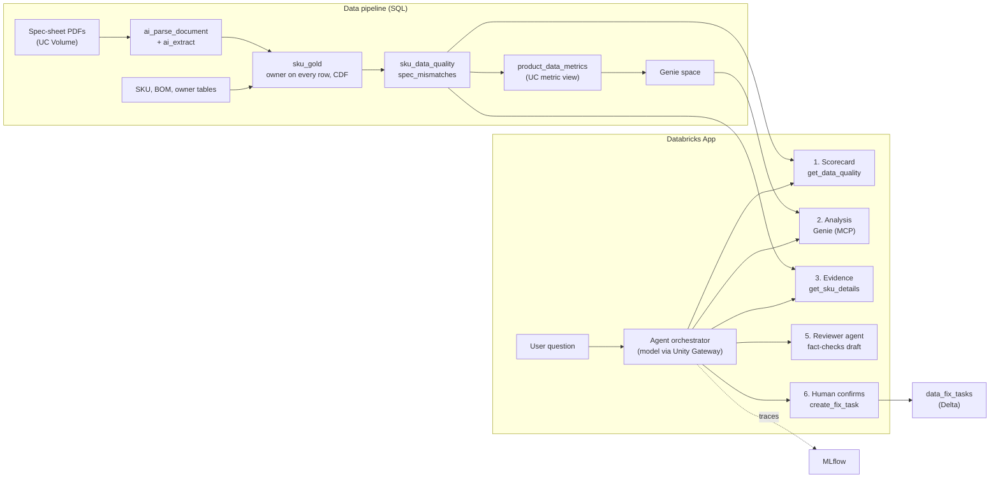
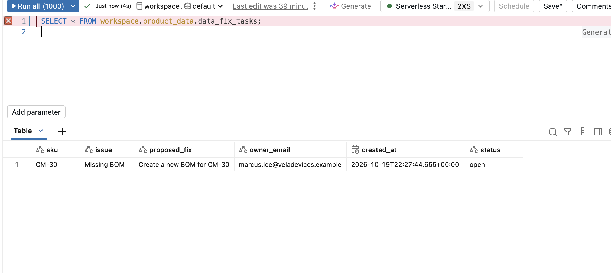
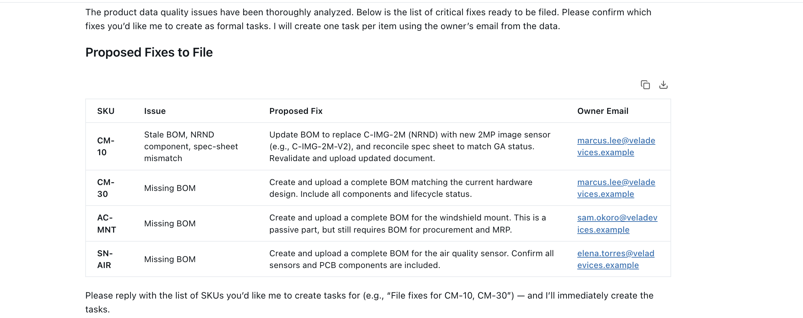
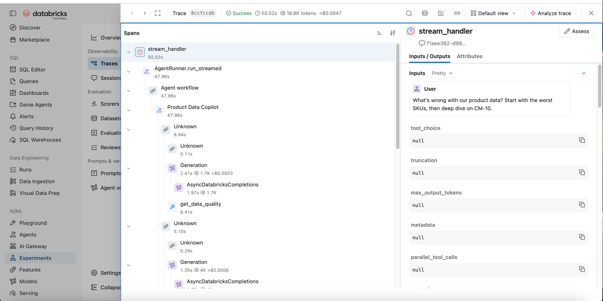

# Product Data Copilot

**A multi-step AI agent on Databricks that finds bad product data (missing BOMs, obsolete parts, spec sheets that disagree with the SKU master), proves each issue with evidence, and files fix tasks to the right owner after a human confirms.**

It's built end to end on Databricks: Document Intelligence → Delta gold layer → Unity Catalog metric view → Genie → agent → Databricks App, with every run traced in MLflow.

> Built from a real problem. In my product data role I chased stale and missing BOMs across PLM, ERP and supply-planning systems, and grew a product information tracker from 32 to 390+ monthly users. This project rebuilds that workflow the Databricks way. The data here is fictional ("Vela Devices").

<!-- Add a demo GIF or video link here: docs/screenshots/demo.gif -->

## Architecture



Unity Catalog governs every table, function, and app permission.

## What it finds

The sample data has planted problems the agent has to discover:

| Issue | SKUs |
|---|---|
| GA product with no BOM | CM-30, SN-AIR, AC-MNT |
| Obsolete component still in a GA BOM | CB-OBD, CB-PWR |
| BOM not updated in over a year | CB-J1939, SN-DOOR, CM-10 |
| Spec sheet disagrees with SKU master | GW-200 (weight), CM-20 (max temp), SN-TPMS (IP rating), CM-10 (sheet says EOL, table says GA) |

## Design decisions

- **SQL computes, the LLM explains.** Quality scores and checks are defined once in governed SQL views and a UC metric view. The agent reads them and never recalculates them, so the numbers are reproducible and auditable.
- **Tools are Unity Catalog functions.** They're governed, reusable by Genie and other agents, and testable on their own in the SQL editor.
- **Schema-constrained PDF extraction.** `ai_extract` uses typed fields and an enum for lifecycle status, so the extracted specs can be joined and compared rather than read as free text.
- **Evidence, then review, then action.** Every flagged SKU gets its BOM and mismatch evidence, a separate reviewer agent checks the draft against raw tool outputs, and writes happen only after the user confirms.
- **Parameterized SQL** in the write tool, so model output can't inject SQL.
- **Model-agnostic.** The model is a config value served through Unity Gateway. I swapped models three times during the build; see [docs/DESIGN.md](docs/DESIGN.md) for what broke and why.

## Repo layout

```
sql/01_raw_data.sql               raw tables, Volume, sample rows
sql/02_parse_spec_sheets.sql      ai_parse_document + ai_extract on the PDFs
sql/02b_fallback_spec_values.sql  same values without AI functions (for workspaces without them)
sql/03_foundation_and_metrics.sql gold table, quality views, metric view, UC function tools
spec_sheets/                      12 sample spec-sheet PDFs
agent_server/agent.py             the agent (drop-in for Databricks' agent template)
databricks.yml                    app bundle: model, Genie, warehouse, function permissions
scripts/setup_app.sh              clones the official template and drops in this agent
tools/generate_sample_data.py     regenerates the sample SQL and PDFs
docs/DESIGN.md                    full design write-up and lessons learned
```

## Run it yourself

Works on [Databricks Free Edition](https://docs.databricks.com/aws/en/getting-started/free-edition).

1. **Data.** In the SQL editor, run `sql/01_raw_data.sql`, upload `spec_sheets/*.pdf` to the `workspace.product_data.spec_sheets` volume, then run `sql/02_parse_spec_sheets.sql` and `sql/03_foundation_and_metrics.sql`.
2. **Genie.** Create a Genie space on `product_data_metrics`, `sku_data_quality`, `spec_mismatches`, `bom_lines` and `components`.
3. **App.** Install `uv`, Node 20 and the Databricks CLI, log in, then:
   ```bash
   ./scripts/setup_app.sh
   ```
   Fill in your Genie space ID, warehouse ID and workspace URL in `app/databricks.yml` and `app/.env`, then:
   ```bash
   cd app && uv run quickstart && uv run start-app            # local
   databricks bundle deploy && databricks bundle run product_data_copilot   # deploy
   ```
4. **Try it.** Ask *"What's wrong with our product data? Start with the worst SKUs, then deep dive on CM-10."*

## Screenshots

<!-- Drop images in docs/screenshots/ and reference them here -->
| Genie | Agent run | MLflow trace |
|---|---|---|
|  |  |  |

## Credits

`agent_server/agent.py` is adapted from Databricks' [app-templates](https://github.com/databricks/app-templates) (`agent-openai-agents-sdk`), used under the Databricks License. See `third_party/databricks-app-templates/`. The rest of the project is my own work.
